# IKIZY: plano de experiência (antes de colocar no ar)

Análise geral do sistema em 10/10/2026, feita a partir do código e de capturas de todas as telas no computador (1440px)
e no celular (375px). **Nada aqui foi implementado ainda.** É o mapa para decidir e depois construir.

Substitui o `docs/fluxos-do-sistema.md` (de 07/10), que ficou desatualizado. Complementa o `CONTEXTO.md`.

Sumário:
1. Princípio que guia tudo
2. Diagnóstico: o que está solto hoje
3. Nova organização (mapa do sistema)
4. Perfis: quem vê o quê
5. Telas, uma a uma: manter, mudar, tirar
6. Todos os fluxos
7. O que fazer antes de ir para o ar (ordem)
8. Decisões que precisam de você
9. Acesso e cadastro: análise e proposta

---

## 1. Princípio que guia tudo

> **O salão abre o IKIZY para ver o dia e atender. Todo o resto é secundário.**

Quem usa o sistema está no meio de um atendimento, com a mão ocupada, no celular. As perguntas que ela faz, em ordem de frequência:

1. **Quem vem agora e depois?** (várias vezes por dia)
2. **Tem pedido novo para confirmar?** (várias vezes por dia)
3. **Encaixa fulana às 15h?** (várias vezes por dia: marcar, remarcar)
4. **Quem eu preciso chamar no WhatsApp hoje?** (1 vez por dia)
5. **Quanto entrou?** (fim do dia / fim do mês)
6. **Meu site está bom?** (de vez em quando)
7. **Minha assinatura, minha equipe, meus serviços** (raramente)

Hoje o sistema está organizado ao contrário: a primeira tela é de números (perguntas 5 e 7), e a agenda do dia (pergunta 1)
só aparece depois de rolar. A proposta inverte isso: **a agenda vira a tela inicial**.

---

## 2. Diagnóstico: o que está solto hoje

### 2.1 Problemas graves (impedem ir para o ar)

| # | Problema | Onde | Por que é grave |
|---|---|---|---|
| G1 | **O Início mostra números inventados para salões reais.** Faturamento da semana, "+12% acima da semana passada", "Outubro em números", ranking de serviços e "meta de R$ 30.000" vêm de dados de exemplo (`data/mock.ts` e `data/finance.ts`), não do banco. | `pages/Dashboard.tsx` | A dona vê R$ 12.890 na semana em que faturou R$ 300. Destrói a confiança no primeiro dia. |
| G2 | **Não existe tela de equipe.** Não dá para cadastrar a 2ª profissional, editar, desativar, nem definir comissão. A agenda só pede "Cadastre quem atende" quando não há nenhuma. O Financeiro diz "Defina o percentual de cada uma" e não há onde definir. | Agenda, Financeiro | Os planos Studio e Salão (equipe) não funcionam de verdade. |
| G3 | **Não existe convite de acesso.** Os papéis gerente, recepção e profissional existem no banco, mas não há como alguém da equipe entrar. | banco `members` | O plano Salão promete "Mais profissionais e permissões". |
| G4 | **Se alguém da equipe entrasse, veria tudo.** As regras do banco deixam qualquer membro ler fechamentos do mês, atendimentos e clientes de todos. | migrations (RLS) | Profissional veria o faturamento do salão e a comissão das colegas. |
| G5 | **Planos prometem o que não existe:** "Relatórios" (Studio), "Mais profissionais e permissões" e "Atendimento prioritário" (Salão). | `lib/plans.ts`, landing | Venda de recurso que não existe. |
| G6 | **Confirmação de e-mail desligada** (seção 5b do `CONTEXTO.md`). | Neon Auth | Contas com e-mail digitado errado ficam sem recuperação de senha. |

### 2.2 Pontas soltas (confundem, mas não quebram)

| # | Ponta solta | Onde |
|---|---|---|
| P1 | A busca do topo ("Buscar cliente ou serviço") não faz nada. | `AppShell.tsx` |
| P2 | Configurações do negócio espalhadas em 5 lugares: nome do negócio em "Minha conta" (avatar); horário de atendimento num botão da Agenda; serviços, preços, WhatsApp e endereço em "Meu site"; custos de produtos em "Meu site" (mas são do Financeiro); assinatura só pelo avatar. | vários |
| P3 | **Serviços moram no "Meu site"**, mas são usados na agenda, no financeiro e no agendamento online. Quem não quer site não acha onde cadastrar serviço. | `MeuSite.tsx` |
| P4 | Pedidos do site aparecem em 3 lugares com textos diferentes: sininho/faixa ("pedidos do site para confirmar") e "Mensagens de hoje" ("Confirmar horário · Aguardando você"). | Início |
| P5 | A grade da agenda é fixa das 8h às 20h, mesmo para quem atende das 13h às 22h. A ocupação do Início usa 9h às 19h fixo. | `lib/agendaTime.ts`, Dashboard |
| P6 | No celular a barra de baixo só tem ícones, sem nome. Assinatura e Minha conta só pelo avatar. | `AppShell.tsx` |
| P7 | No celular a agenda não tem lista do dia: só a grade, uma profissional por vez (sem "Todas"). A lista do dia existe, mas só no computador. | `Agenda.tsx` |
| P8 | Tamanho das telas no celular: **Início = 5 telas de rolagem**, Financeiro = 4,5, Agenda = 2,5 (o 1º atendimento aparece só na 2ª tela). | capturas |
| P9 | Clientes no celular: bolinha de seleção (envio em massa) sempre visível em toda linha, e 4 números no topo antes da lista. | `Clientes.tsx` |
| P10 | Pedidos do site só avisam com o sistema aberto. | `PendingRequests.tsx` |
| P11 | Rotas desconhecidas em `/dashboard/*` mostram "Em construção · em breve". | `Placeholder.tsx` |
| P12 | Documentação desatualizada: `fluxos-do-sistema.md` diz que Clientes e Financeiro usam dados de exemplo (não usam mais) e que o cadastro cria plano Solo direto (hoje há escolha de plano); `CONTEXTO.md` fala da branch `dev` (não existe mais) e do cartão fidelidade como feito (foi removido). | docs |

### 2.3 O que está bom e deve ficar

- **Agenda no computador**: calendário + lista do dia + grade por profissional, menu do botão direito, status com cores, linha do "agora", horário fechado hachurado. É a melhor tela do sistema.
- **Ficha da cliente**: resumo, ficha/anamnese, histórico, anotações, fotos de antes e depois.
- **Financeiro com dados reais**: recibo do mês, fechamento que trava o mês, comissões, formas de pagamento, saídas.
- **Meu site**: guia em 2 passos, prévia fiel, paletas fixas, publicar.
- **Cadastro e questionário**: curto, bonito, já monta serviços.
- **Mensagens prontas no WhatsApp** (sem disparo automático, por decisão sua).
- **Pedidos do site** (sininho, faixa, aviso) recém-feitos.

---

## 3. Nova organização (mapa do sistema)

### 3.1 Antes e depois

```
HOJE                                    PROPOSTA
────────────────────────────────        ────────────────────────────────────────
Início (números, quase tudo falso)  →   (sai; o útil vai para Agenda e Financeiro)
Agenda                              →   AGENDA = tela inicial (dia, semana, mês)
Clientes                            →   CLIENTES (+ "chamar hoje")
Financeiro                          →   FINANCEIRO (+ caixa do dia + mês em números)
Meu site                            →   MEU SITE (só a vitrine pública)
(espalhado)                         →   MEU NEGÓCIO (novo: dados, horário, serviços,
                                         equipe, custos, assinatura, conta)
```

### 3.2 Navegação

**Celular (barra de baixo, com nome embaixo do ícone):**

```
┌──────────────────────────────────────────────┐
│  Agenda   Clientes   [ + ]   Caixa    Mais   │
└──────────────────────────────────────────────┘
```

- **[ + ]** no meio, maior: novo agendamento de qualquer tela (é a ação mais repetida do dia).
- **Caixa** = Financeiro (nome mais curto e mais claro para o dia a dia).
- **Mais** abre: Meu site, Meu negócio (serviços, equipe, horário...), Assinatura, Minha conta, Sair.

**Computador (topo):**

```
IKIZY.   Agenda  Clientes  Financeiro  Meu site      [🔍 Buscar cliente]  [🔔 2]  [+ Agendar]  (ME ▾)
```

- O avatar abre um menu: Meu negócio, Assinatura, Minha conta, Sair.
- A busca passa a funcionar: digita o nome, aparece a cliente; Enter abre a ficha.

### 3.3 Mapa de rotas proposto

```
/dashboard                 → Agenda (hoje)            [era o Início]
/dashboard/agenda          → redireciona para /dashboard (links antigos continuam valendo)
/dashboard/clientes[/:id]  → Clientes / ficha
/dashboard/financeiro      → Financeiro (abre no caixa de hoje; mês ao lado)
/dashboard/site            → Meu site
/dashboard/negocio         → Meu negócio (novo), com seções:
        #dados  #horario  #servicos  #equipe  #custos
/dashboard/assinatura      → Assinatura (continua, mas entra pelo Mais/avatar)
/convite/:token            → aceitar convite da equipe (novo)
```

---

## 4. Perfis: quem vê o quê

Hoje, na prática, só existe a **dona**. A proposta define os 4 perfis que o banco já prevê.

| Área | Dona | Gerente | Recepção | Profissional |
|---|---|---|---|---|
| Agenda de todas | ✅ | ✅ | ✅ | ❌ só a dela ("Minha agenda") |
| Marcar / remarcar / cancelar | ✅ | ✅ | ✅ | ✅ só na agenda dela |
| Confirmar pedidos do site | ✅ | ✅ | ✅ | ✅ só os dela |
| Concluir com forma de pagamento | ✅ | ✅ | ✅ | ✅ só os dela |
| Clientes: lista e ficha | ✅ | ✅ | ✅ | ✅ só as que já atendeu ou tem marcadas |
| Clientes: total gasto, ticket | ✅ | ✅ | ❌ | ❌ |
| Mensagens prontas (WhatsApp) | ✅ | ✅ | ✅ | ✅ das clientes dela |
| Financeiro do salão | ✅ | ✅ | ❌ (só o caixa do dia) | ❌ |
| "Meus ganhos" (comissão própria) | — | — | — | ✅ |
| Fechar o mês | ✅ | ✅ | ❌ | ❌ |
| Meu site | ✅ | ✅ | ❌ | ❌ |
| Meu negócio: serviços, horário | ✅ | ✅ | ❌ | ❌ (pode ver o próprio horário) |
| Meu negócio: equipe e convites | ✅ | ✅ (menos mudar a dona) | ❌ | ❌ |
| Assinatura e pagamento | ✅ | ❌ | ❌ | ❌ |

**Por plano:**
- **Solo:** só a dona; a dona é a profissional. Nada de equipe, comissão ou convite aparece.
- **Studio:** equipe sem limite rígido de acessos? → *decisão sua (seção 8)*. Sugestão: até 3 profissionais e convites.
- **Salão:** equipe maior, papéis de recepção e gerente.

**Importante (G4):** antes de liberar convites, as regras do banco precisam acompanhar a tabela acima
(profissional não lê `month_closings`, não lê comissão das outras, não vê atendimento de outras).
Esconder na tela não basta: a Data API é aberta ao navegador.

---

## 5. Telas, uma a uma: manter, mudar, tirar

Legenda: **Manter** · **Mudar** · **Tirar** · **Novo**

### 5.1 Agenda (vira a tela inicial)

**Celular — proposta (o 1º atendimento aparece sem rolar):**

```
┌─────────────────────────────────┐
│ IKIZY.                🔔2  (ME) │
│                                 │
│ Sáb, 11 de outubro      [Hoje]  │  ← toque abre o mês
│ ‹ Qui Sex [Sáb] Dom Seg Ter ›   │  ← faixa de dias, arrasta
│ 9 atendimentos · R$ 1.960       │
│ ─────────────────────────────── │
│ ┌ 2 pedidos do site ─────────┐  │  ← só se houver
│ │ Fernanda · Nail art · 16:00│  │
│ │      [Recusar] [Confirmar] │  │  ← confirma direto aqui
│ └────────────────────────────┘  │
│ AGORA                           │
│ ┃11:30 Marina Costa   ● Em at.  │
│ ┃      Esmaltação · Ana         │
│ ┃      [Concluir e receber]     │  ← ação do momento
│ PRÓXIMOS                        │
│  12:00 Larissa Nunes  Confirm.  │
│        Lash lifting · Bia  [💬] │  ← 💬 = lembrete pronto
│  13:30 Patrícia Lima  Confirm.  │
│  ┄┄ 15:00–16:00 livre ┄┄  [+]  │  ← buraco livre: toque marca
│  16:00 Fernanda Rocha Aguard.   │
│ JÁ ATENDIDAS (3)            ▾   │  ← recolhido
├─────────────────────────────────┤
│ Agenda Clientes [+] Caixa  Mais │
└─────────────────────────────────┘
```

- **Mudar:** no celular a visão padrão vira **lista do dia** (não a grade). A grade continua num botão "Grade" para quem quer.
- **Mudar:** filtro de profissional vira um seletor "Todas ▾" no topo (hoje são chips, e "Todas" some no celular).
- **Novo:** horários livres aparecem como buracos tocáveis na lista ("15:00–16:00 livre [+]").
- **Novo:** o atendimento em andamento ganha destaque e o botão do próximo passo (Iniciar / Concluir e receber).
- **Novo:** botão 💬 em cada linha com a mensagem certa do momento (confirmação, lembrete, pós-atendimento).
  Isso **substitui o card "Mensagens de hoje"** do Início para tudo que é ligado a atendimento.
- **Mudar:** pedidos do site com **Confirmar / Recusar direto na faixa** (sem abrir o atendimento) e, ao confirmar, abre o WhatsApp com a mensagem pronta.
- **Mudar:** "Horário de atendimento" sai da agenda e vai para Meu negócio (fica um atalho no menu ⋯ da agenda).
- **Mudar:** a grade usa o horário real do salão (do primeiro início ao último fim cadastrados), não 8h–20h fixo.
- **Tirar:** legenda de cores no rodapé no celular (o status vai escrito na linha).

**Computador — proposta (mantém o que já funciona, ajusta o topo):**

```
┌────────────────────────────────────────────────────────────────────────────────────┐
│ Sáb, 11 out  ‹ Hoje ›   [Dia | Semana | Mês]   Todas ▾     9 atend. · R$ 1.960  [+ Agendar] │
├───────────────┬────────────────────────────────────────────────────────────────────┤
│ Calendário    │ ┌ 2 pedidos do site ───────────── [Recusar] [Confirmar] ┐            │
│ do mês        │ └───────────────────────────────────────────────────────┘            │
│               │      Ana Clara        Bia Souza        Carla Mendes                  │
│ Lista do dia  │ 09 ┃ Juliana ✓      ┃ Camila ✓       ┃                               │
│ (agora,       │ 10 ┃                ┃                ┃ Luciana ✓                     │
│  próximos,    │ 11 ┃ Marina ●       ┃                ┃              ── agora ──      │
│  atendidas)   │ 12 ┃                ┃ Larissa        ┃ Aline                          │
│               │ ...                                                                  │
│ Chamar hoje   │                                                                      │
│ (aniversário, │                                                                      │
│  sumidas: 3)  │                                                                      │
└───────────────┴────────────────────────────────────────────────────────────────────┘
```

- **Manter:** calendário + lista + grade, botão direito, linha do agora.
- **Novo:** visão **Semana** de verdade na grade (hoje "Semana" só muda o calendário pequeno).
- **Novo:** cartão "Chamar hoje" (aniversário e sumidas) na coluna da esquerda, que é o resto do "Mensagens de hoje".

### 5.2 Início (sai)

| Bloco de hoje | Destino |
|---|---|
| Previsto hoje / No caixa / Concluídos | Topo da Agenda ("9 atendimentos · R$ 1.960") e Caixa do dia no Financeiro |
| Teste grátis (cartão preto grande) | **Tira** do meio da tela. Vira uma linha discreta no menu Mais/avatar e o aviso amarelo só quando faltar ≤ 7 dias (já existe: `BillingBanner`) |
| Pedidos do site | Agenda |
| Faturamento da semana (falso) | Financeiro, com dado real |
| Próximos atendimentos | É a própria Agenda |
| Mensagens de hoje | Agenda (💬 por atendimento) + "Chamar hoje" (aniversário, sumidas) |
| Outubro fecha em X dias | Financeiro (já existe lá: "Pronta para fechar outubro?") |
| Outubro em números (falso) | Financeiro, com dado real (ticket, ocupação, faltas, atendimentos) |
| Serviços que mais rendem (falso) | Financeiro, com dado real (já existe a "Composição" e o recibo por categoria) |

**Alternativa**, se você quiser manter um painel: deixar o Início só para dona/gerente, **com dados reais**, e a Agenda como tela
inicial de todo mundo. Ver decisão D1.

### 5.3 Clientes

```
CELULAR
┌─────────────────────────────────┐
│ Clientes                  [+ ]  │
│ [🔍 Buscar nome ou telefone   ] │
│ Todas · Chamar hoje (5) · VIP · │  ← "Chamar hoje" = aniversário,
│ Novas · Sumidas                 │     sumidas, retorno atrasado
│ ─────────────────────────────── │
│ (MC) Marina Costa       VIP 🎂  │
│      Última visita há 2 dias    │
│ (DF) Débora Freitas      Nova   │
│ ...                             │
│              [Selecionar várias]│  ← modo seleção só quando pedir
└─────────────────────────────────┘
```

- **Manter:** lista, busca, filtros, ficha completa, anamnese, fotos, mensagem pronta, envio para várias.
- **Mudar:** as 4 bolinhas de números (Ativas, Novas, Retorno, Sumidas) saem do topo no celular; vão para o Financeiro/relatório ou ficam só no computador.
- **Mudar:** a bolinha de seleção só aparece depois de tocar em "Selecionar várias".
- **Novo:** filtro **"Chamar hoje"** (quem tem motivo para receber mensagem hoje).
- **Mudar (perfil):** recepção e profissional não veem "Total gasto" nem ticket da cliente.
- **Manter:** ficha em tela cheia no celular, com voltar.

### 5.4 Financeiro (Caixa)

```
CELULAR
┌─────────────────────────────────┐
│ Caixa         [Hoje | Mês]      │
│                                 │
│ HOJE · sáb, 11 out              │
│ Recebido      R$ 640            │
│ A receber     R$ 1.320 (6)      │
│ Pix 400 · Crédito 240           │
│ ─────────────────────────────── │
│ Recebimentos de hoje            │
│  09:00 Juliana  Pix   R$ 220    │
│  09:30 Camila   Créd. R$ 260    │
│ [+ Lançar saída]                │
└─────────────────────────────────┘
(aba Mês = o que existe hoje: recibo, fechamento, comissões, saídas,
 + "mês em números" e "serviços que mais rendem" vindos do Início, com dado real)
```

- **Novo:** aba **Hoje** (caixa do dia): quanto entrou, por forma de pagamento, o que falta receber. É o que a recepção usa.
- **Manter:** aba Mês inteira (recibo, fechar o mês, comissões, saídas, exportar, enviar no WhatsApp).
- **Mudar:** no celular, o recibo vai para o fim (ou para um botão "Ver recibo"), e o resumo (bruto, lucro, margem) vem primeiro. Hoje o recibo fica no meio da rolagem.
- **Mudar:** "Produtos e custos" sai do Meu site e vem para cá (ou para Meu negócio → Custos), porque é dinheiro, não site.
- **Novo (profissional):** "Meus ganhos": atendimentos concluídos e comissão do mês, só dela.

### 5.5 Meu site

- **Manter:** guia em 2 passos, prévia, paleta, fonte, logo, capa, textos, vitrine de produtos, planos por assinatura, publicar, agendamento online.
- **Mudar:** serviços: o cadastro passa a ser em Meu negócio → Serviços; no Meu site fica só "o que aparece no site" (mostrar/esconder, foto, ordem).
- **Mudar:** WhatsApp, Instagram, endereço e horário escrito vêm de Meu negócio → Dados (um lugar só; o site lê de lá).
- **Tirar:** etapa "Produtos e custos" (vai para o Financeiro/Meu negócio).
- Resultado: 3 etapas em vez de 4: **Página · Serviços no site · Vitrine**.

### 5.6 Meu negócio (novo)

```
┌─────────────────────────────────┐
│ Meu negócio                     │
│ Dados do negócio            ›   │  nome, endereço, WhatsApp, Instagram
│ Horário de atendimento      ›   │  por profissional (já existe o diálogo)
│ Serviços                    ›   │  nome, preço, duração, categoria, quem faz
│ Equipe                      ›   │  profissionais, comissão, acesso (convite)
│ Custos de material          ›   │  (hoje "Produtos e custos" no Meu site)
│ Assinatura                  ›   │  plano, pagamento
└─────────────────────────────────┘
```

- **Novo:** é a "casa" de tudo que hoje está espalhado (P2, P3).
- **Equipe**: lista de profissionais; adicionar, editar nome/especialidade, comissão %, desativar; "Dar acesso" gera convite (link para mandar no WhatsApp) com o papel (profissional, recepção, gerente).
- **Serviços**: ganha "quem faz" (cada profissional marca os serviços dela), que também resolve o item "Serviço × profissional" do agendamento online.

### 5.7 Topo, conta e assinatura

- **Mudar:** busca do topo passa a funcionar (clientes e, depois, atendimentos).
- **Mudar:** avatar abre menu (Meu negócio, Assinatura, Minha conta, Sair) em vez de abrir direto o formulário de nome.
- **Manter:** Assinatura como está (planos, Pix adiantado, cartão, portal Stripe).
- **Mudar:** textos dos planos sem promessa do que não existe (G5) até existir.
- **Manter:** `BillingBanner` (aviso só quando precisa agir).
- **Tirar:** cartão grande "21 dias grátis" do topo da tela inicial (fica uma linha no menu e o aviso nos últimos 7 dias).

### 5.8 Acesso (login, cadastro, questionário, plano)

Análise completa e proposta na **seção 9**. Em resumo: o cadastro passa de 8 a 9 telas para 3
(criar conta com nome · código · seu negócio), sai a escolha de serviços, preços e plano do cadastro,
e a pessoa cai na Agenda com os Primeiros passos. Também entra a tela de aceitar convite (`/convite/:token`, fase 2).

---

## 6. Todos os fluxos

### 6.1 Chegada: do site até o primeiro dia

Detalhado na **seção 9** (análise do cadastro e proposta de 3 telas). Resumo:

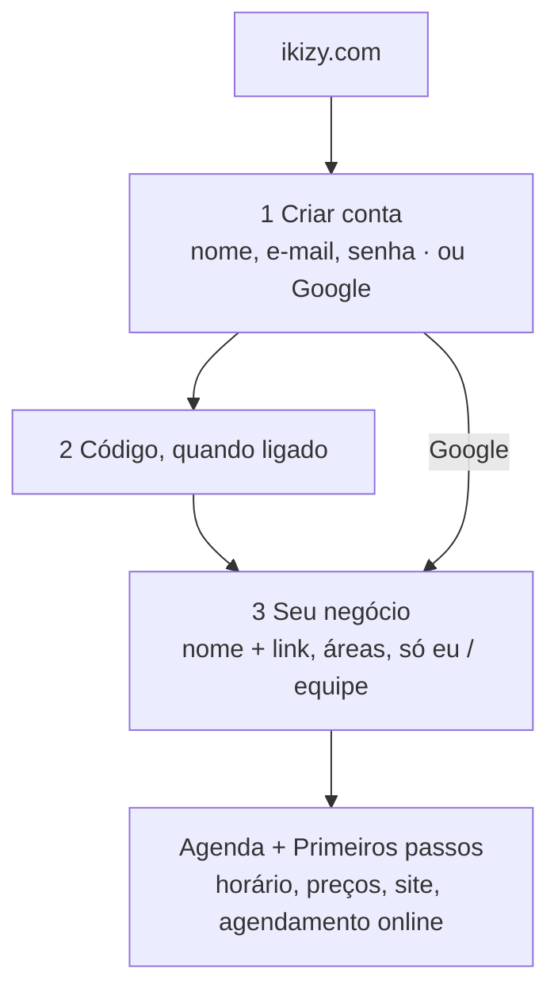

O que muda: hoje são 8 a 9 telas e cai no Início com números de exemplo; passam a ser 3 telas e cai na Agenda com o roteiro.

### 6.2 Dia a dia da dona (Solo), no celular

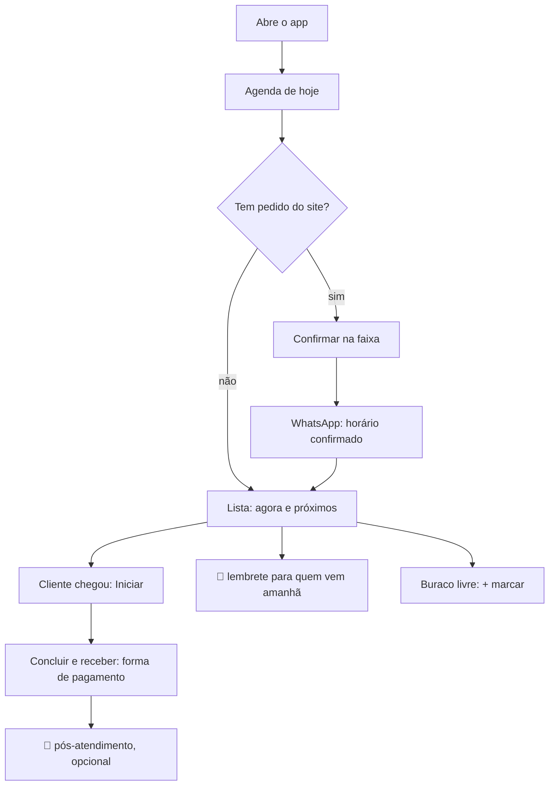

### 6.3 Marcar um horário (pedido por WhatsApp ou telefone)

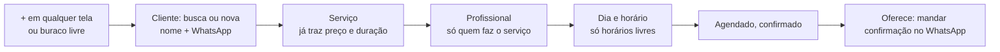

Hoje já é quase assim; muda: "só quem faz o serviço" (depende de Serviço × profissional) e a oferta de mensagem no fim.

### 6.4 Pedido pelo site

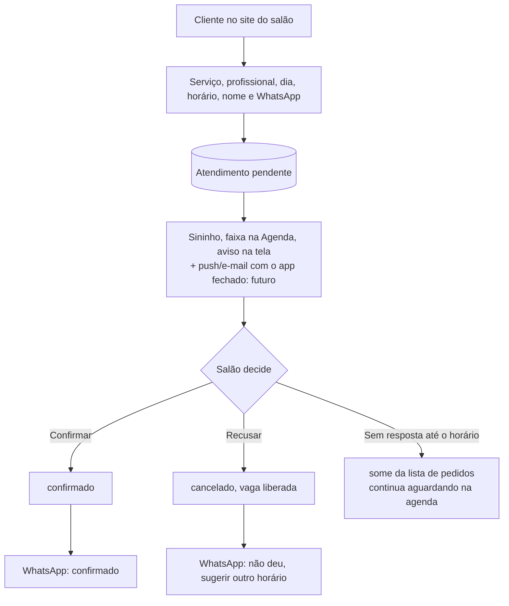

O que falta: Confirmar/Recusar direto na faixa e a mensagem de recusa (hoje só existe a de confirmação).

### 6.5 Remarcar, cancelar, falta

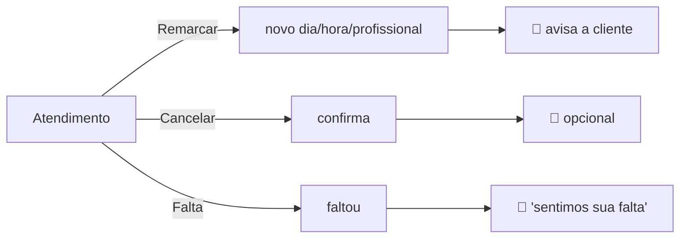

Já existe. Muda só a oferta de mensagem depois de cada ação (hoje só ao confirmar).

### 6.6 Clientes e relacionamento

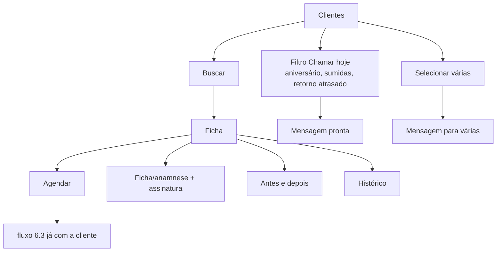

### 6.7 Dinheiro

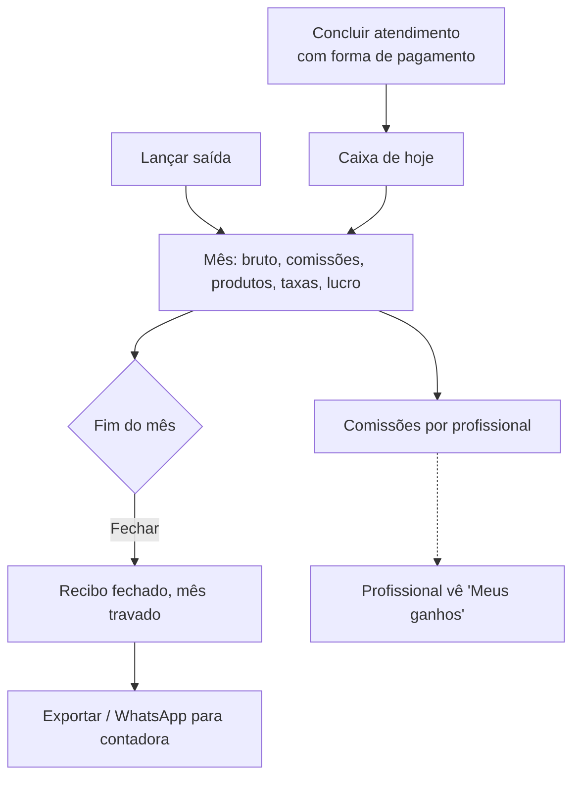

### 6.8 Equipe (novo)

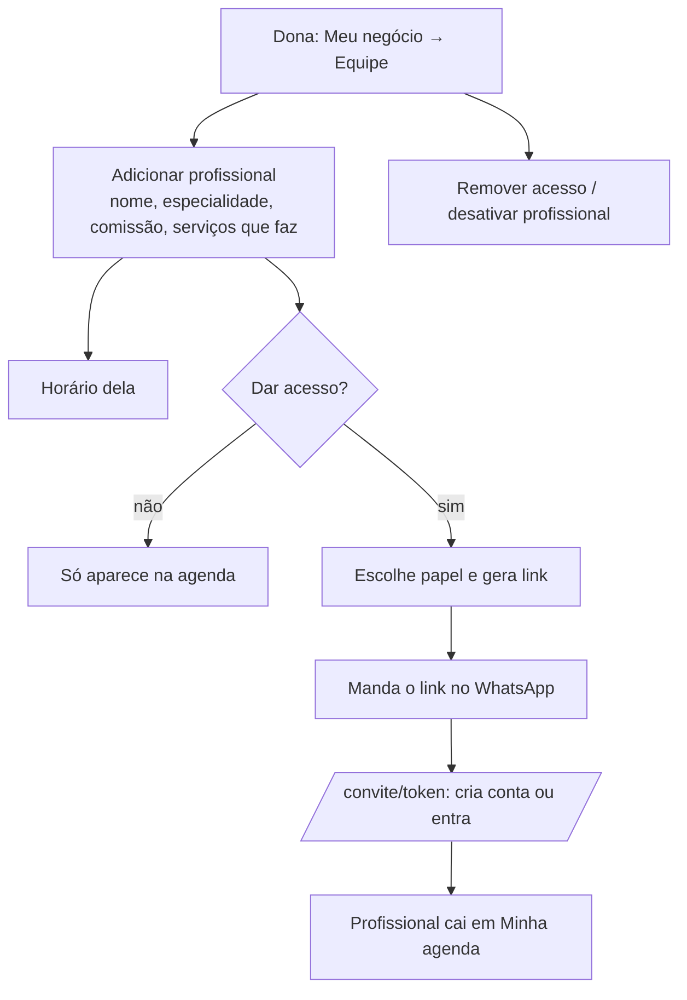

### 6.9 Site

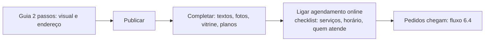

### 6.10 Assinatura

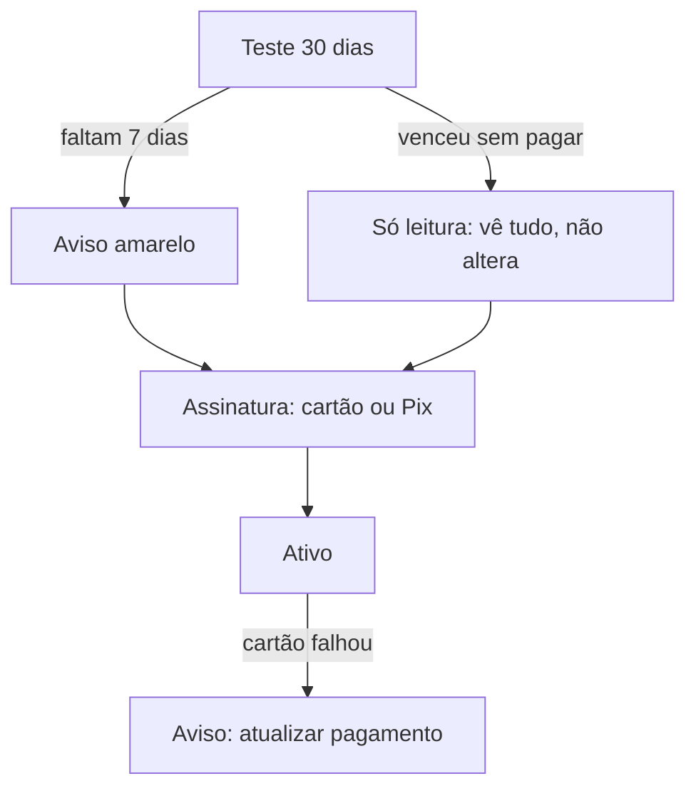

Já existe. Muda só onde se entra (menu Mais/avatar e o aviso).

### 6.11 Profissional (com acesso, novo)

```
CELULAR — Minha agenda
┌─────────────────────────────────┐
│ Olá, Bia                🔔1     │
│ Sáb, 11 out · 4 atendimentos    │
│ AGORA  12:00 Larissa · Lash     │
│        [Iniciar]                │
│ 14:30 Beatriz · Manutenção      │
│ ...                             │
├─────────────────────────────────┤
│ Agenda  Clientes  [+]  Ganhos   │
└─────────────────────────────────┘
```

Vê só a agenda dela, as clientes dela e "Ganhos" (comissão do mês). Sem Financeiro, Meu site, Meu negócio, Assinatura.

### 6.12 Recepção (com acesso, novo)

Agenda de todas, Clientes (sem valores gastos), Caixa de hoje, [+]. Sem mês, comissões, site, negócio, assinatura.

---

## 7. O que fazer antes de ir para o ar (ordem)

### Fase 1 — Obrigatório para lançar (salão Solo funcionando redondo)

1. **Tirar os números falsos** (G1): a Agenda vira a tela inicial; o que for útil do Início vai para o Financeiro com dado real.
2. **Agenda no celular em lista do dia** (P7, P8), com buracos livres, ação do momento e 💬 por atendimento.
3. **Confirmar/Recusar pedido direto na faixa** + mensagem de recusa.
4. **Barra de baixo com nomes e o botão [+]** (P6).
5. **Meu negócio** com Dados, Horário, Serviços e Custos (P2, P3); Meu site fica só com a vitrine.
6. **Grade com o horário real** do salão (P5).
7. **Busca do topo funcionando** (P1) ou retirada até funcionar.
8. **Planos sem promessas falsas** (G5) e **confirmação de e-mail** (G6).
9. **Novo cadastro em 3 telas + Primeiros passos** na Agenda vazia (seção 9.6, itens 1 a 7).
10. Atualizar `CONTEXTO.md` e apagar/arquivar `fluxos-do-sistema.md` (P12).

### Fase 2 — Para vender Studio e Salão (equipe)

11. **Equipe** em Meu negócio: adicionar, editar, comissão, desativar, serviços que faz (G2).
12. **Regras do banco por papel** (G4) — antes de qualquer convite.
13. **Convite de acesso** e tela `/convite/:token` (G3).
14. **Visões por perfil**: Minha agenda + Ganhos (profissional), Caixa de hoje (recepção).
15. **Agenda em semana** na grade do computador.

### Fase 3 — Depois do lançamento

16. App instalável + notificação com o sistema fechado (P10).
17. Lembretes automáticos, sinal por Pix, link da cliente para remarcar (já listados no `CONTEXTO.md` 9.1).

---

## 8. Decisões que precisam de você

| # | Decisão | Opções | Recomendação |
|---|---|---|---|
| D1 | O que fazer com o Início? | (a) some; Agenda vira a tela inicial e os números vão para o Financeiro · (b) fica só para dona/gerente, com dados reais, e a Agenda é a tela inicial | **(a)**: menos telas, nada duplicado. |
| D2 | Nome da aba de dinheiro | "Financeiro" · "Caixa" | **"Caixa"** no celular, "Financeiro" no computador, ou "Caixa" nos dois. |
| D3 | Equipe entra antes ou depois do lançamento? | lançar só Solo e equipe na fase 2 · esperar a fase 2 | **Lançar com Solo** (e Studio/Salão como "em breve" ou só com profissionais sem acesso). |
| D4 | Profissional vê clientes de quem? | só as dela · todas sem valores | **Só as dela.** |
| D5 | Limite de profissionais por plano | Studio até 3, Salão ilimitado · outro | Studio até 3, Salão ilimitado. |
| D6 | Botão [+] central no celular | sim · não | **Sim**: é a ação mais repetida do dia. |
| D7 | Recusar pedido manda mensagem? | sempre oferece · não | **Sempre oferece** (a cliente precisa saber). |
| D8 | Plano e pagamento no cadastro? | tirar do cadastro (teste começa sozinho) · manter a tela do plano no fim | **Tirar**: o site promete "sem cartão" e pedir cartão no 1º minuto afasta. |
| D9 | Serviços no cadastro? | nenhum (catálogo inicial automático, preços nos Primeiros passos) · lista curta para marcar | **Automático**: a pessoa só ajusta preço depois, já dentro do sistema. |
| D10 | "Quem atende" no cadastro | Só eu / Eu e equipe · as 3 opções de hoje | **2 opções**. |
| D11 | Horário padrão criado sozinho | seg–sáb 9h–19h · deixar vazio | **Seg–sáb 9h–19h**, confirmado no 1º passo. |

---

## 9. Acesso e cadastro: análise e proposta

Revisado em 10/10/2026: código de todas as telas de acesso (`pages/auth/*`, `AuthProvider`, `RequireSalon`, cobrança)
e capturas no computador e no celular. **Não testei um cadastro real de ponta a ponta**, porque o app local usa o banco
de produção e isso criaria contas e salões de verdade. O que está abaixo vem da leitura do código e das telas.

### 9.1 Como é hoje (do site até a agenda)

| # | Tela | O que pede | Observação |
|---|---|---|---|
| 1 | `/cadastro` | e-mail e senha (ou Google) | não pede o nome |
| 2 | `/verificar-email` | código de 6 números | só quando a confirmação estiver ligada (hoje está desligada) |
| 3 | Questionário 1 | O que você oferece? (7 áreas) | |
| 4 | Questionário 2 | Como é a sua equipe? (Só eu / 2 a 5 / 6 ou mais) | avança sozinho ao tocar, sem botão |
| 5 | Questionário 3 | Como você se chama? | **só** para quem atende sozinha |
| 6 | Questionário 4 | Quais serviços você faz? | tudo vem marcado; com 3 áreas são **16 pílulas para desmarcar** e 3 campos "Outro serviço"; no celular são 2 telas de rolagem |
| 7 | Questionário 5 | Quanto você cobra? | **um campo de preço para cada serviço** (16 campos); a duração aparece e não dá para mudar |
| 8 | Questionário 6 | Nome do negócio e endereço da página | |
| 9 | `/cadastro/plano` | plano (3 cartões) + "Cartão de crédito" (vai para o Stripe) ou "Pix, sem cartão" | |
| 10 | Início | | cai nos números de exemplo (G1) |

São **8 a 9 telas** até começar a usar, e duas delas (serviços e preços) são listas longas.

### 9.2 Funciona? Problemas encontrados

**Funciona e está bem amarrado:**
- Entrar, criar conta, Google, esqueci a senha, link de redefinir (inclusive link vencido), código de e-mail com reenvio e espera de 60 s.
- Criar conta com um e-mail que já existe e a senha certa: entra e segue de onde parou (boa decisão).
- Senha certa com e-mail não confirmado: vai para a tela do código, em vez de dizer "senha incorreta".
- Quem fecha o navegador no meio volta para o passo certo: sem negócio → questionário; sem plano escolhido → tela do plano.
- Voltar do Stripe (pago ou cancelado) é tratado.
- Sair da conta limpa a sessão e volta para o login.

**Problemas (do mais grave para o menos):**

| # | Problema | Efeito para a pessoa |
|---|---|---|
| A1 | **Quem escolhe "equipe" não informa o próprio nome e não entra como profissional.** O nome só é pedido para quem atende sozinha. | O topo mostra "Olá, mariae.duardad3216" (pedaço do e-mail). A agenda abre pedindo "Cadastre quem atende", e depois não há como cadastrar a segunda (G2). |
| A2 | **A tela do plano ignora a resposta da equipe.** Sempre começa marcado o Solo. | Quem disse "6 pessoas ou mais" pode seguir no Solo sem perceber. |
| A3 | **Pede cartão no primeiro minuto.** "Cartão de crédito" é o primeiro botão e leva ao Stripe antes de ver o sistema. O site promete **"30 dias grátis, sem cartão"**. | Muita gente desiste aqui. A promessa do site e a tela não combinam. |
| A4 | **"Pix, sem cartão" na verdade significa "decidir depois".** Ninguém paga nada nessa hora. | Confunde: parece que vai gerar um Pix. |
| A5 | **Serviços: marcar tudo e pedir para desmarcar.** | É o passo que você sentiu como ruim: trabalho ao contrário, lista longa, no celular cansa. |
| A6 | **Preços: um campo por serviço, e "Pular" deixa todos a R$ 0.** | Agenda e site mostram R$ 0,00; o agendamento online não liga enquanto não houver preço. |
| A7 | **A barra de progresso muda de tamanho no meio.** Começa com 4 tracinhos e vira 5 ou 6 conforme as respostas. | Passa a sensação de que "não acaba nunca". |
| A8 | **Os rótulos somem quando o campo é preenchido** (o nome do campo é só o texto de dentro). Na tela do negócio, "Studio Maria Beauty" e "studio-maria-beauty" ficam um embaixo do outro sem dizer o que é cada um. | Dúvida sobre o que é "endereço" (rua? link?). |
| A9 | **O endereço da página só é conferido no fim.** Se já existir, o erro aparece depois de tudo preenchido. | Frustração no último passo. |
| A10 | **Recarregar a página no questionário apaga todas as respostas.** | Quem sai para ver uma mensagem no WhatsApp volta e recomeça. |
| A11 | **Se salvar os serviços ou a profissional falhar, ninguém é avisado** (o negócio é criado, o resto some em silêncio). | Agenda e site vazios sem explicação. |
| A12 | **O plano escolhido no site (ikizy.com) se perde.** Os botões dos cartões de plano levam para `/cadastro` sem dizer qual plano. | Escolhe Studio no site e tem de escolher de novo. |
| A13 | **E-mails do código e da senha saem como "Neon Auth"** (`auth@mail.myneon.app`), provavelmente com o texto padrão do Neon. | Parece golpe; cai no spam (seção 5b do `CONTEXTO.md`). |
| A14 | **Entrar não devolve para onde a pessoa ia.** Quem abre um link do sistema (ex.: um pedido) sem estar logada vai para o login e, depois, para a tela inicial, não para o pedido. | Quebra os avisos de pedido e os futuros links de notificação. |
| A15 | **No celular, o fundo de pontinhos passa por trás dos textos pequenos** (subtítulo, termos de uso) e o conteúdo fica no meio da tela com um espaço vazio grande em cima. | Leitura difícil; o teclado cobre o botão em telas pequenas. |
| A16 | **O botão do Google é uma pílula pequena ao lado do título.** | Mais da metade das pessoas prefere Google; o botão principal parece secundário. |

### 9.3 Proposta: do site à agenda em 3 telas

Ideia central: **não fazer a pessoa escolher nada que o sistema pode adivinhar**, e deixar o que é detalhe
(preço de cada serviço, horário, site) para os **Primeiros passos dentro do sistema**, já com a agenda na frente.

```
ANTES (8 a 9 telas)                        DEPOIS (3 telas + código quando ligado)
──────────────────────────────────         ──────────────────────────────────────────
1 Cadastro (e-mail, senha)                 1 Criar conta: nome, e-mail, senha  (ou Google)
2 Código                                   2 Código (quando ligado)
3 Áreas                              ┐
4 Equipe                             │
5 Seu nome (só solo)                 ├──►  3 Seu negócio: nome do negócio, áreas, equipe
6 Serviços (desmarcar)               │       (uma tela só, sem lista de serviços)
7 Preços (16 campos)                 │
8 Nome e endereço                    ┘
9 Plano + cartão/Pix                 ──►   (sai do cadastro: teste começa sozinho)
10 Início (números falsos)           ──►   Agenda + Primeiros passos
```

**Tela 1 — Criar conta**

```
CELULAR
┌─────────────────────────────────┐
│ IKIZY.                  Entrar  │
│                                 │
│ Crie sua conta                  │
│ 30 dias grátis, sem cartão.     │
│                                 │
│ [ G  Continuar com Google     ] │  ← botão grande, primeiro
│ ─────────── ou ───────────      │
│ Seu nome                        │  ← rótulo fixo em cima
│ [ Maria Eduarda               ] │
│ E-mail                          │
│ [ maria@email.com             ] │
│ Senha                           │
│ [ ••••••••               👁   ] │
│ Mínimo de 8 caracteres.         │
│                                 │
│ [        Criar conta     →    ] │
│ Ao continuar, você concorda...  │
└─────────────────────────────────┘
```

- **Novo:** o nome é pedido aqui (resolve A1 para todo mundo, inclusive equipe).
- **Mudar:** Google vira o botão grande do topo (A16); rótulos fixos em cima dos campos (A8).
- **Mudar:** o texto "30 dias grátis, sem cartão" aparece aqui, igual ao site.
- **Mudar:** se a pessoa veio de um cartão de plano do site (`/cadastro?plano=studio`), o plano já fica guardado (A12).

**Tela 2 — Código** (quando a confirmação estiver ligada): igual à de hoje, com os 6 números em caixinhas separadas e colar automático.

**Tela 3 — Seu negócio (uma tela só)**

```
CELULAR
┌─────────────────────────────────┐
│ IKIZY.                          │
│ Seu negócio                     │
│                                 │
│ Nome do negócio                 │
│ [ Studio Maria Beauty         ] │
│ Seu link: studiomaria.ikizy.com │  ← ✓ disponível (confere ao digitar)
│           Trocar link           │
│                                 │
│ O que você faz?                 │
│ (Unhas)(Cílios)(Sobrancelha)    │  ← toca para marcar, nada pré-marcado
│ (Cabelo)(Barbearia)(Estética)   │
│ (Outro)                         │
│                                 │
│ Quem atende?                    │
│ [ Só eu | Eu e equipe ]         │  ← 2 opções, não 3
│                                 │
│ [    Criar meu negócio   →    ] │
└─────────────────────────────────┘
```

- **Mudar:** nome do negócio, áreas e equipe numa tela só, sem barra de progresso que cresce (A7).
- **Mudar:** o link (`studiomaria.ikizy.com`) é criado sozinho a partir do nome e conferido enquanto digita ("✓ disponível"); "Trocar link" só para quem quiser (A8, A9).
- **Mudar:** "Quem atende" com 2 opções (Só eu / Eu e equipe). O número exato não serve para nada no cadastro.
- **Tirar:** passos de serviços e preços do cadastro (A5, A6).
- **Novo:** guardar o que já foi digitado no navegador, para não perder ao recarregar (A10).

**O que o sistema faz sozinho ao criar o negócio:**
- Cria a dona como profissional da agenda, com o nome da tela 1, nos dois casos (só eu ou com equipe) (A1).
  Se a dona não atende, ela mesma desativa depois em Equipe.
- Cria um **catálogo inicial curto**: os 3 ou 4 serviços mais comuns de cada área marcada (não 7), com a duração sugerida
  e **sem preço**. Os preços entram no Primeiro passo 2.
- Cria o horário padrão **seg a sáb, 9h às 19h**, que a pessoa confirma ou ajusta no Primeiro passo 1.
- Inicia o teste de 30 dias no plano que combina com a resposta (Só eu → Solo; Eu e equipe → Studio), ou no plano que veio do site (A2).
- Se alguma parte falhar, mostra o aviso no Primeiros passos ("Não conseguimos criar seus serviços, crie aqui") (A11).

**Plano e pagamento saem do cadastro (A3, A4).** O teste começa sem perguntar nada, como o site promete.
A escolha de plano e a forma de pagamento aparecem:
- numa linha discreta no menu (Mais / avatar): "Teste grátis · 21 dias · Ver planos";
- no aviso amarelo nos últimos 7 dias (já existe);
- em Assinatura, a qualquer momento.

**Primeiros passos (no topo da Agenda vazia, some quando tudo estiver feito)**

```
┌─────────────────────────────────┐
│ Deixe seu negócio pronto   1/4  │
│ ✓ Conta criada                  │
│ ○ Confirme seu horário      ›   │  seg–sáb 9h–19h já preenchido
│ ○ Coloque os preços         ›   │  uma lista curta: serviço · R$ · duração
│ ○ Publique seu site         ›   │  abre o guia de 2 passos do Meu site
│ ○ Receba agendamentos       ›   │  liga o agendamento online
│                    [Depois]     │
└─────────────────────────────────┘
```

- Cada item abre uma tela curta e volta para a agenda.
- "Coloque os preços" mostra só os serviços criados (3 ou 4 por área), com preço e duração editáveis,
  "+ outro serviço" e "remover". É aqui que a pessoa ajusta, já vendo para que serve.
- Quem tem equipe ganha um 5º item: "Cadastre sua equipe".

### 9.4 Entrar (login) e recuperar senha

- **Manter:** e-mail e senha, "Esqueci", Google, mensagem que não revela se o e-mail existe.
- **Mudar:** mesmo visual da Tela 1 (Google grande em cima, rótulos fixos) (A16, A8).
- **Mudar:** depois de entrar, voltar para a página que a pessoa tentou abrir (ex.: o pedido) (A14).
- **Mudar:** lembrar o último e-mail usado neste aparelho.
- **Mudar no celular:** conteúdo começa no alto (não centralizado), fundo de pontinhos só nas bordas, nunca atrás de texto (A15).
- **Mudar:** e-mails do código e da senha com remetente e texto do IKIZY, em português (A13; depende do SMTP próprio, seção 5b do `CONTEXTO.md`).

### 9.5 Novo fluxo completo

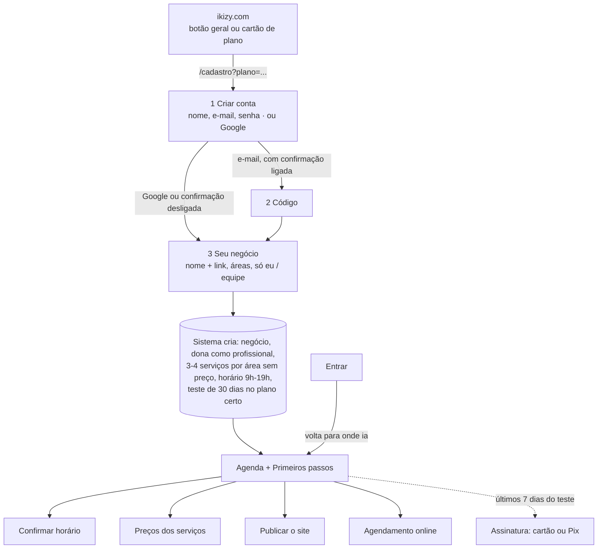

### 9.6 Ordem de execução do acesso

Entra na **Fase 1** (seção 7):
1. Nome no cadastro e dona sempre como profissional (A1).
2. "Seu negócio" em uma tela, link conferido ao digitar, rascunho guardado (A7 a A10).
3. Catálogo inicial curto sem preço + horário padrão + Primeiros passos com preços (A5, A6, A11).
4. Tirar o plano do cadastro; teste começa no plano certo; `?plano=` vindo do site (A2, A3, A4, A12).
5. Visual de entrar/criar conta: Google grande, rótulos fixos, celular sem fundo atrás do texto (A8, A15, A16).
6. Voltar para a página pedida depois do login (A14).
7. SMTP próprio + ligar a confirmação de e-mail (A13, G6).
