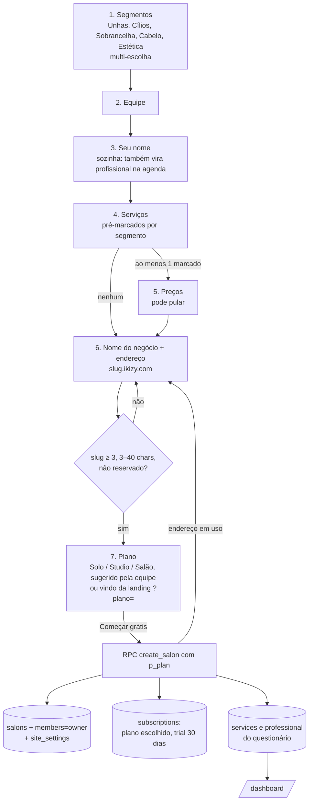
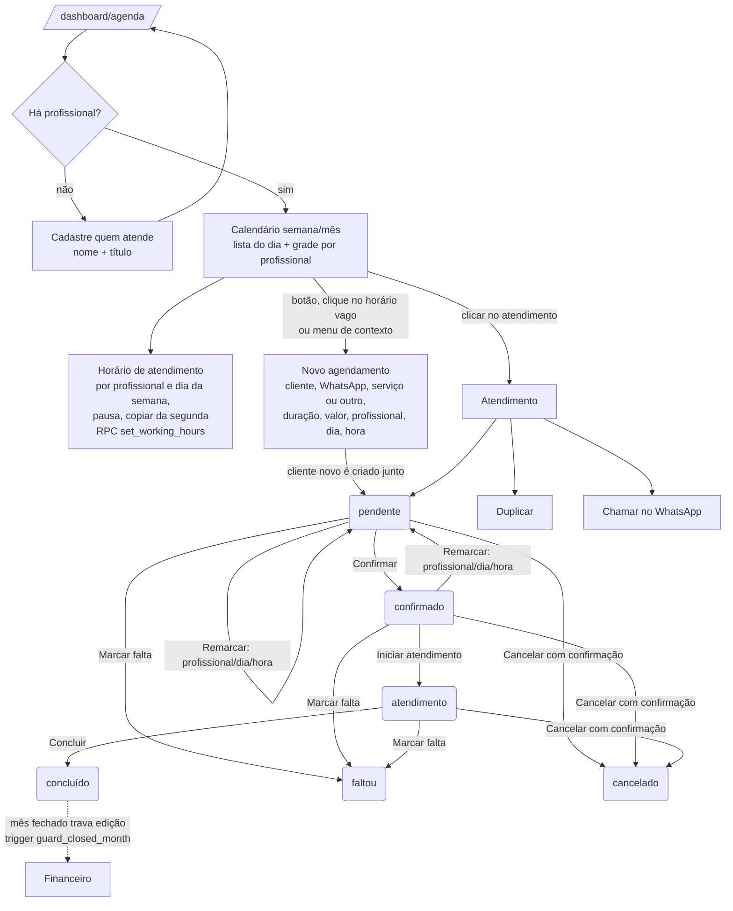
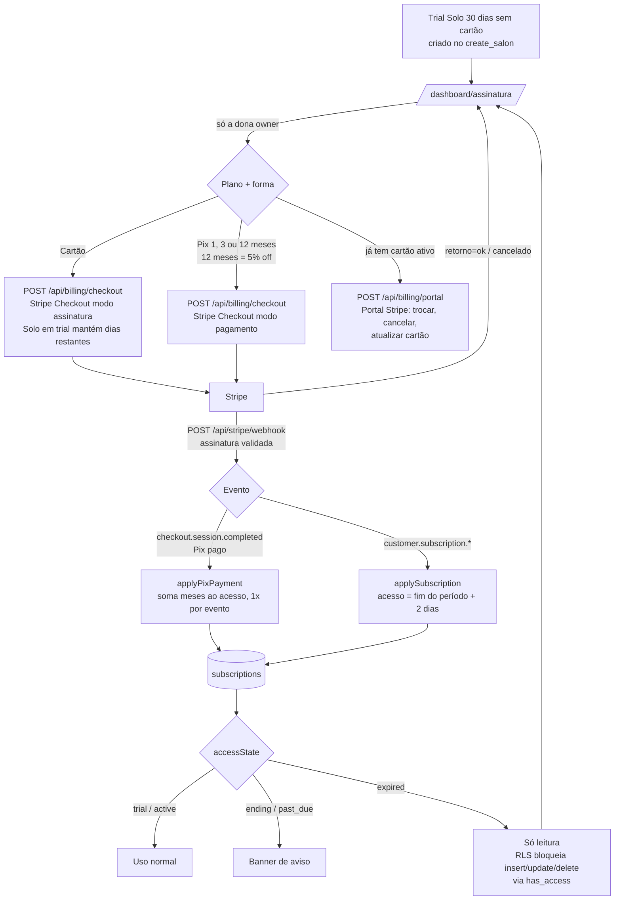

# IKIZY — fluxos de cadastro e uso

Levantado do código em 07/10/2026 (branch `dev`, inclui alterações ainda não commitadas).
Renderiza em GitHub, VS Code (extensão Mermaid) ou https://mermaid.live.

## 1. Visão geral (do site ao uso diário)

```mermaid
flowchart TD
    L[Landing ikizy.com<br/>recursos, planos, FAQ, contato] -->|Criar conta| C
    L -->|Entrar| LG

    subgraph ACESSO [app.ikizy.com — acesso]
        C[/cadastro<br/>e-mail + senha ≥ 8 ou Google/]
        LG[/login<br/>e-mail + senha ou Google/]
        RS[/recuperar-senha/]
        RD[/redefinir-senha?token/]
        CF{{Confirmar e-mail}}
        C -->|e-mail/senha| CF -->|link no e-mail| LG
        C -->|Google| OAuth[Google OAuth] --> G
        LG -->|Google| OAuth
        LG -->|Esqueci| RS -->|link no e-mail| RD -->|nova senha| LG
        LG -->|ok| G
    end

    G{Guarda RequireSalon<br/>estado da sessão}
    G -->|sem sessão| LG
    G -->|sessão, sem negócio| OB
    G -->|sessão + negócio| D

    OB[/cadastro/salao<br/>Onboarding em passos/] -->|create_salon + serviços + profissional| D

    subgraph SISTEMA [/dashboard — sistema]
        D[Início] --- AG[Agenda] --- CL[Clientes] --- FN[Financeiro] --- SI[Meu site]
        D --- AS[Assinatura]
        PF[Minha conta<br/>editar nome / negócio / sair]
    end

    D -.->|banner se teste acabando,<br/>Pix vencendo, cartão falhou, sem acesso| AS
```

## 2. Onboarding (/cadastro/salao)



## 3. Agenda



## 4. Clientes, Financeiro, Meu site, Início

```mermaid
flowchart LR
    subgraph CLI [/dashboard/clientes e /:id]
        C1[Lista com busca e filtros por tag] --> C2[Ficha: ligar, WhatsApp, agendar,<br/>selos de fidelidade, preferências,<br/>últimos atendimentos, antes e depois,<br/>anamnese pendente/assinada]
    end
    subgraph FIN [/dashboard/financeiro]
        F1[Escolhe o mês] --> F2[KPIs, composição do faturamento,<br/>comissões, formas de pagamento]
        F2 --> F3{Mês aberto?}
        F3 -->|sim| F4[Fechar mês → RPC close_month<br/>snapshot imutável]
        F3 -->|fechado| F5[Recibo: imprimir / baixar]
    end
    subgraph SITE [/dashboard/site]
        S1[Aba Página: endereço, nome, frase,<br/>sobre, WhatsApp, Instagram, horário,<br/>mostrar preços/equipe, sinal Pix] --> S4
        S2[Aba Serviços: nome, preço, duração, visível] --> S4
        S3[Aba Produtos: gasto médio mensal] --> S4
        S4[Prévia] --> S5[Publicar]
        S6[Checklist: agendamento pelo site] -.-> S1
    end
    subgraph INI [/dashboard]
        I1[Faturamento da semana, próximos atendimentos,<br/>clientes para contatar, fechamento do mês,<br/>mês em números, ranking de serviços]
    end
```

> Estado dos dados hoje: **Agenda** e **cadastro/onboarding** usam o Neon de verdade.
> **Início, Clientes, Financeiro e Meu site** ainda leem dados de exemplo
> (`data/mock.ts`, `clients.ts`, `finance.ts`, `catalog.ts`) — o schema existe no banco, mas as telas não gravam lá.

## 5. Assinatura e pagamento



## 6. Permissões

| Papel | Pode |
|---|---|
| owner | tudo, inclusive pagar/gerenciar assinatura e membros |
| manager | editar negócio, serviços/produtos |
| reception, professional | ler e operar agenda/clientes (policy `is_member`) |

Na interface hoje só aparece o fluxo da dona (a criação de membros extras ainda não tem tela).
